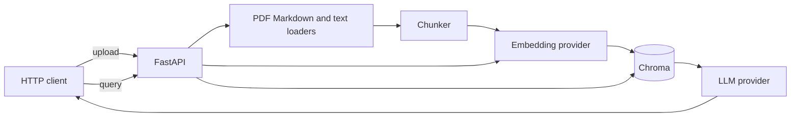

# llm-rag-api

Portfolio demo by [Arpan Bom](https://github.com/applycoding).

This is a small retrieval-augmented generation service: upload a PDF, Markdown, or text file, chunk and embed it, then ask a question and get an answer with citations. It is a public GitHub sample of the shape of that system, not a production RAG platform. There is no authentication, no tenancy, no reranker, and no evaluation harness.

The default configuration needs no API keys. Embeddings are a local hashing embedder (lexical overlap, not a semantic model), and the default generator quotes the best matching sentences from the retrieved chunks. OpenAI, Anthropic, Gemini, Mistral, DeepSeek, and Ollama are real HTTP adapters selected by configuration. Their tests mock HTTP. They are not a claim that a live key was used, and the default model names are starting points that you should override when a vendor renames a model.

## Features

- `POST /documents` accepts `.pdf`, `.md`, `.markdown`, and `.txt`, extracts text, and chunks it with overlap.
- Chunks are embedded and stored in Chroma. Tests and a local run use an embedded database. Docker Compose runs a Chroma server.
- `POST /query` returns an answer plus the retrieved chunks (filename, page, score, text) as citations.
- `POST /query/stream` sends the same citations, then tokens, as server-sent events.
- The LLM provider is chosen with `RAG_LLM_PROVIDER`: `fake`, `openai`, `anthropic`, `gemini`, `mistral`, `deepseek`, or `ollama`.
- Embeddings are `local` or `openai`. Local mode is the one the tests and the default demo use.
- An empty corpus returns a fixed “nothing to cite” answer instead of calling a model.
- Pydantic settings, Dockerfile, Compose, pytest, ruff, and GitHub Actions.

## Architecture



Upload path: the loader pulls text (per page for PDFs), the chunker packs it into overlapping windows, the embedding provider returns vectors, and Chroma stores the vectors with filename, page, and document id.

Query path: the same embedder encodes the question, Chroma returns the nearest chunks, and the selected LLM sees those chunks as numbered sources. Citations in the JSON response are the retrieved chunks, not a second parse of the model output. The offline provider quotes up to two overlapping sentences and marks them with `[1]` or `[2]`. Cloud providers receive the same prompt and are asked to cite those numbers.

Changing the embedding provider or the vector size means starting a new Chroma directory or collection. The two embedding spaces are not interchangeable.

## Tech stack

- Python 3.12, FastAPI, Pydantic Settings
- Chroma 0.6.3 (embedded or the `chromadb/chroma:0.6.3` server)
- pypdf for PDF text, httpx for provider calls
- pytest, ruff, Docker, GitHub Actions

## How to run

Local, with the offline provider:

```bash
python -m venv .venv
source .venv/bin/activate
pip install -e ".[dev]"
uvicorn app.main:app --reload
```

Open `http://127.0.0.1:8000/docs`. Data is written to `./data/chroma`.

API and Chroma in Docker:

```bash
docker compose up --build
```

The API listens on port 8000 and talks to Chroma inside the Compose network. The Chroma port on the host is 8001, for inspection only. The Compose file sets `RAG_LLM_PROVIDER=fake`.

To call a hosted model, copy `.env.example` to `.env` and set the provider plus its key. Settings use the `RAG_` prefix, for example `RAG_LLM_PROVIDER=openai` and `RAG_OPENAI_API_KEY`. Set `RAG_LLM_MODEL` when you want a specific model. Ollama is `RAG_LLM_PROVIDER=ollama` and by default calls `http://127.0.0.1:11434` with model `llama3.1`. From Compose, point `RAG_OLLAMA_BASE_URL` at the host.

OpenAI embeddings are optional: `RAG_EMBEDDING_PROVIDER=openai`. Wipe `./data/chroma` (or the Compose volume) before mixing them with vectors from the local embedder.

## API examples

Upload the sample note and ask where embeddings are stored. With the offline provider the answer is an extractive quote, not a generated paragraph.

```bash
curl -s -F "file=@examples/retrieval-notes.md" http://127.0.0.1:8000/documents

curl -s http://127.0.0.1:8000/query \
  -H 'content-type: application/json' \
  -d '{"question":"Where are embeddings stored?"}'
```

Against `examples/retrieval-notes.md`, the offline provider returns this. The document id changes on every upload. The score is the local embedder's cosine similarity for that file, and `text` is the retrieved chunk (trimmed below).

```json
{
  "answer": "Embeddings are stored on disk for similarity search. [1] This demo stores embeddings in Chroma. [1]",
  "citations": [
    {
      "index": 1,
      "document_id": "…",
      "filename": "retrieval-notes.md",
      "chunk_index": 0,
      "page": null,
      "score": 0.325,
      "text": "# Retrieval notes\n\nThis demo stores embeddings in Chroma. …"
    }
  ],
  "provider": "fake",
  "model": "fake-extractive"
}
```

Stream the same question:

```bash
curl -N http://127.0.0.1:8000/query/stream \
  -H 'content-type: application/json' \
  -d '{"question":"Where are embeddings stored?"}'
```

Events are `citations`, then one `token` event per piece, then `done`:

```text
event: citations
data: {"citations":[...]}

event: token
data: {"text":"Embeddings "}

event: done
data: {"answer":"...","provider":"fake","model":"fake-extractive"}
```

Other calls:

```bash
curl -s http://127.0.0.1:8000/health
curl -s http://127.0.0.1:8000/documents
curl -s -X DELETE http://127.0.0.1:8000/documents/DOCUMENT_ID
```

`GET /health` reports the active provider and whether Chroma is embedded or HTTP. Uploads are limited to 8 MiB and 2000 chunks. There is no auth on any route.

## Tests

```bash
pip install -e ".[dev]"
ruff check .
ruff format --check .
pytest
```

`make check` runs the same lint and tests. GitHub Actions does too, on Python 3.12.

The suite covers chunking, the local embedder's ranking, the offline answer and its stream, request shapes for every cloud provider and Ollama (mocked httpx, no network), upload/query/delete for text and PDF, empty-corpus behavior, and the Chroma HTTP client switch. It does not call paid APIs and it does not start the Compose stack.

## License

MIT. Copyright 2026 Arpan Bom.
