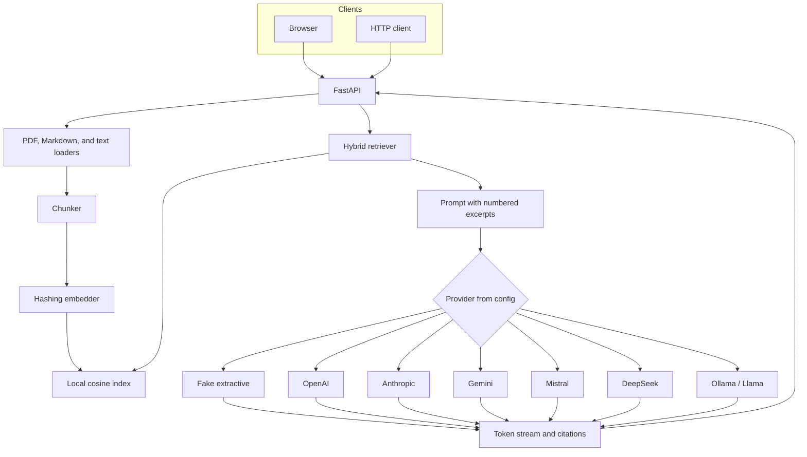

# llm-rag-api

A small **portfolio demo** of a retrieval-augmented generation service. It ingests PDF, Markdown, and text, chunks and embeds them in a local vector index, and answers questions with citations. A config switch selects OpenAI, Anthropic, Gemini, Mistral, DeepSeek, a local Llama model through Ollama, or an offline fake provider.

This is a demo, not a production RAG platform. The default path never calls a hosted model, so the UI, tests, and evaluation script run with no API keys. The bundled corpus (Lumen Archive) is fictional.

## Architecture



Ingestion turns a file into overlapping chunks. Each chunk becomes a hashed bag-of-words vector. Search ranks chunks by a blend of cosine similarity and token overlap, then drops weak hits. The prompt contains only those excerpts. Every provider, including the fake one, sees that same prompt.

The fake provider does not generate prose. It quotes the retrieved sentences that share the most words with the question and marks them `[1]`, `[2]`. Hosted adapters are thin HTTP clients. CI checks their request shape against recorded responses. It does not call paid APIs.

The index is a JSON file of vectors and chunk text (`LocalVectorIndex`). Chroma or FAISS would sit behind that same class. They are not bundled: a native vector library would make the image and the tests heavier without changing the demo.

## Run it

```bash
python -m venv .venv
source .venv/bin/activate
pip install -e ".[dev]"
python -m app.evaluate
uvicorn app.main:app --reload
```

Open http://127.0.0.1:8000 and choose **Load sample corpus**. Ask one of the suggested questions. The status line should show provider `fake`.

The same flow from the shell:

```bash
curl -s -X POST http://127.0.0.1:8000/v1/documents/sample
curl -s http://127.0.0.1:8000/v1/query \
  -H 'content-type: application/json' \
  -d '{"question":"How long does Lumen Archive retain audit logs?"}'
```

Streaming uses server-sent events:

```bash
curl -N http://127.0.0.1:8000/v1/query/stream \
  -H 'content-type: application/json' \
  -d '{"question":"Which regions are supported?"}'
```

Events are `citations`, `token`, `done`, and `error`.

### Docker

```bash
docker compose up --build
```

The container starts on the fake provider and ingests `sample_docs/` when the index is empty. The index is stored in the `rag-data` volume.

## API

| Method | Path | Purpose |
| --- | --- | --- |
| GET | `/health` | Provider, model, and index counts |
| GET | `/v1/providers` | Every adapter and whether a key is configured |
| POST | `/v1/documents` | Multipart upload (`.pdf`, `.md`, `.markdown`, `.txt`) |
| POST | `/v1/documents/text` | JSON body `{text, source, title}` |
| POST | `/v1/documents/sample` | Index the bundled corpus |
| GET | `/v1/documents` | List indexed documents |
| DELETE | `/v1/documents/{id}` | Remove one document |
| POST | `/v1/reset` | Clear the index |
| POST | `/v1/query` | JSON answer plus citations |
| POST | `/v1/query/stream` | Same answer as SSE |

Interactive schemas are at `/docs`.

## Providers

Set `RAG_LLM_PROVIDER` and, for a hosted model, that vendor's key. Override the model with `RAG_LLM_MODEL`. Copy `.env.example` to `.env` if you want the variables in a file.

| Provider | `RAG_LLM_PROVIDER` | Key variable | Default model |
| --- | --- | --- | --- |
| Offline extractive | `fake` | none | `fake-extractive` |
| OpenAI Chat Completions | `openai` | `RAG_OPENAI_API_KEY` | `gpt-5.4-mini` |
| Anthropic Messages | `anthropic` | `RAG_ANTHROPIC_API_KEY` | `claude-haiku-4-5` |
| Gemini `streamGenerateContent` | `gemini` | `RAG_GEMINI_API_KEY` | `gemini-3.8-flash` |
| Mistral Chat Completions | `mistral` | `RAG_MISTRAL_API_KEY` | `mistral-small-latest` |
| DeepSeek Chat Completions | `deepseek` | `RAG_DEEPSEEK_API_KEY` | `deepseek-flash` |
| Ollama, meant for Llama | `ollama` | none | `llama3.2` |

Model ids move. Treat the defaults as a starting point and check the vendor's current model list before spending credit. Base URLs are also settings (`RAG_OPENAI_BASE_URL`, `RAG_OLLAMA_BASE_URL`, and the matching variables for the other hosts).

Ollama must already be running and the tag must be pulled:

```bash
ollama pull llama3.2
RAG_LLM_PROVIDER=ollama uvicorn app.main:app
```

Any Ollama tag works. `llama3.2` is only the default. Point `RAG_OLLAMA_BASE_URL` at another host if Ollama is not on `127.0.0.1:11434`.

Other useful settings: `RAG_TOP_K`, `RAG_CHUNK_SIZE`, `RAG_CHUNK_OVERLAP`, `RAG_MIN_SCORE`, `RAG_DATA_DIR`, `RAG_SAMPLE_DIR`, `RAG_AUTO_INGEST`, `RAG_MAX_TOKENS`, `RAG_REQUEST_TIMEOUT_S`.

## Evaluation

```bash
python -m app.evaluate
```

After `pip install`, the `rag-eval` command does the same thing. The script builds a throwaway index from `sample_docs/`, asks five questions, and exits non-zero unless each one retrieves the expected file, includes the expected words, and cites a numbered excerpt. It always uses the fake provider, so a key in your environment does not change the score.

## Tests

```bash
pytest -q
ruff check .
```

GitHub Actions runs both, plus the evaluation script and a Docker image build.

## Limitations

- Retrieval is lexical hashing plus token overlap. A paraphrase that shares no content words will miss, and the service will say it does not know.
- The fake provider quotes the index. It does not summarize, compare, or refuse beyond that extractive rule.
- Hosted adapters are not integration-tested against live APIs in CI.
- There is no authentication, tenancy, reranker, or OCR. A scanned PDF indexes as empty and is rejected.
- The index is one JSON file in a single process. It is appropriate for this corpus, not for a large collection.
- The sample policies, prices, and regions are invented for the demo.
